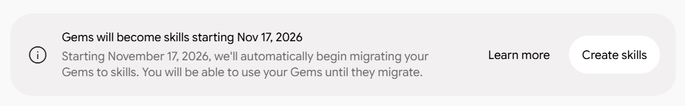
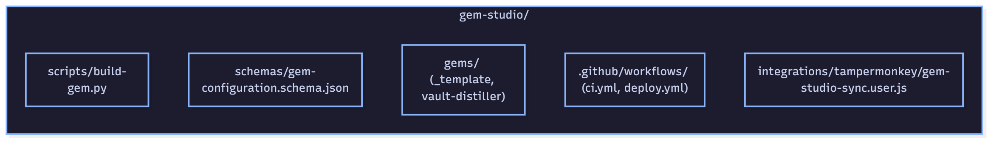
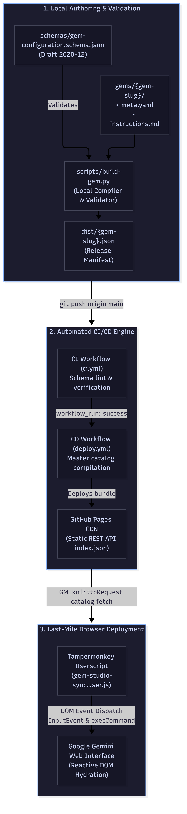
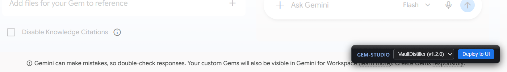

# The Illusion of "Custom Assistants" Is Dead: Why You Need Prompt-as-Code

*Part 1 of 9 in the series "GemStudio: Prompt-as-Code & Declarative AI Systems" · ⏱️ 7 - 8 min read*

> **Series Context:** This inaugural article diagnoses the systemic failure of consumer web-form assistant stores and establishes the **Prompt-as-Code** engineering paradigm, presenting the ***gem-studio*** repository architecture as an open standard for reproducible AI operations.

---

In late 2023, the tech industry fell in love with a shiny new toy: custom assistant marketplaces. First came OpenAI's GPT Store, followed shortly by Google's rollout of Gems across Gemini.

The corporate pitch sounded effortless: anyone, without touching a single line of code, could bundle system instructions, attach a few reference PDFs, and click their way to a tailored assistant directly in a browser tab.

Today, looking at real-world production environments, the outcome is undeniable: **the "prompt app store" model—confining passive micro-assistants to closed web forms—has hit a dead end.**

Let's be clear: the vast majority were trivial wrappers around basic instructions. Now that foundation models boast native deep reasoning and context windows spanning millions of tokens, nearly every workflow that once justified a dedicated assistant can be executed cleanly in a single turn.

Yet the core failure isn't model capability; it is operational architecture. Attempting to build production workflows by pasting prompts into proprietary textareas—grappling with visual web builders without linters, without data contracts, without automated tests, and without version control—isn't software engineering. It is reckless technical debt. If your system directives live trapped inside a vendor's web form, you don't own your intellectual property: you are merely holding your operational logic hostage to a third party's UI churn.

---

## The Catalyst: Deprecating Gems and the Rise of Skills

This shift is not theoretical speculation; the platform providers confirmed it themselves. The decisive event that prompted me to formalize this series and open-source ***gem-studio*** was Google's formal announcement: all custom Gems will be automatically migrated to Skills starting on **November 17, 2026** (Figure 1).

- **Figure 1 (Official Google announcement on the migration from Gems to Skills):**

This is far more than cosmetic branding. It is an industry-level admission that passive, chat-bound bots are obsolete. Traditional Gems and Custom GPTs operate as reactive silos that only wake up when typed at. Modern agentic systems, by contrast, require autonomous task execution, external tool calling, and decoupled orchestration.

If you built your assistants directly inside a web form, announcements like this trigger anxiety, lock-in, and painful manual migrations. But when you treat operational intelligence under **Prompt-as-Code** discipline, the paradigm flips: your specifications and contracts live in an isolated Git repository, completely insulated from vendor UI redesigns.

---

## Form Traps: Why Consumer Visual Builders Fail to Scale

The traditional workflow pushed by SaaS platforms for assistant configuration carries systemic flaws that break under engineering scrutiny:

### 1. The Wrapper Trap and the Illusion of Defensibility

Stitching basic instructions into a web form creates a false sense of a defensive moat. In practice, most assistants did little more than enforce output schemas or summarize static files. As foundation models evolve and integrate native tools, the marginal value of these wrappers evaporates, leaving behind orphaned catalogs and subscription overhead that cannot be justified.

### 2. Vendor Lock-In and Platform Churn

Building inside someone else's form binds your business logic to their interface lifecycle. When the provider revamps the editor, rolls out mandatory migrations, or changes background runtime defaults, you are forced to rebuild everything by hand. Developing in a commercial web builder doesn't grant you ownership: it turns you into a tenant renting space in an unversioned database.

### 3. The Collapse of Separation of Concerns (SoC)

A standard web form collapses dimensions that software architecture demands be decoupled into a single unstructured text box: declarative metadata (authorship, SemVer), procedural logic (algorithmic steps, guardrails), and behavioral tone. Shoving all of this into one flat prompt means that a simple adjustment to tone requires editing the exact same file containing critical business logic, drastically raising the risk of breaking functionality.

---

## The Solution: Prompt-as-Code and Declarative Infrastructure

To eliminate the fragility of visual editors, model behavior and system constraints must be governed with the exact same rigor applied to modern infrastructure.

Under the **Prompt-as-Code** methodology:

- **Git as the Single Source of Truth:** Zero assistants are edited live inside vendor consoles. Every behavioral or stylistic iteration originates in a local repository, tracked via atomic conventional commits and Semantic Versioning (*SemVer*).
- **Declarative Contracts via JSON Schema (Draft 2020-12):** Operational configuration stops being free-form text and becomes an immutable contract (***schemas/gem-configuration.schema.json***). The schema enforces strict typing and rejects arbitrary fields via ***additionalProperties: false***, guaranteeing payload purity.
- **Physical Separation of Concerns:** The architecture cleanly decouples structured configuration from procedural documentation. Metadata and runtime tools are declared in YAML (***meta.yaml***), while execution algorithms and style rules live in pure Markdown (***instructions.md*** and ***tone-and-style.md***). This lets engineers leverage standard IDE tooling, syntax highlighting, and static linters.
- **Deterministic and Immutable Compilation:** A lightweight compiler validates the modular sources against the schema and outputs an immutable release manifest (***dist/{gem-slug}.json***), ready for automated pipelines or programmatic consumption.

---

## Introducing GemStudio: A Production Reference Architecture

To ground these concepts in production, I designed and implemented ***gem-studio***, an open-source development ecosystem that brings Platform Engineering and DevOps workflows to Gemini assistant development.

- **Figure 2 (GemStudio repository topology and modular separation):**

### The Software Supply Chain: From Git to the Web UI

***gem-studio*** eliminates manual console tinkering through an automated pipeline divided into three decoupled stages (Figure 3):

- **Figure 3 (GemStudio end-to-end CI/CD and browser delivery pipeline):**

1. **Local Authoring & Pre-Flight Validation:** Every assistant is developed in an isolated directory under ***gems/{gem-slug}/***. A local compiler processes the directives and validates them strictly against the JSON Schema contract before writing release manifests to disk.
2. **Automated CI/CD Engine & Decoupled Distribution:** The continuous integration pipeline validates schemas on every commit and compiles an index catalog (***index.json***), deploying it statically to high-availability CDN infrastructure.
3. **Last-Mile Delivery via Client-Side Injection:** Because personal accounts lack public API endpoints for programmatic Gem deployment, synchronization is resolved at runtime: a dedicated userscript fetches the remote catalog and reactively hydrates Gemini's Single Page Application (Figure 4), updating targets like ***VaultDistiller v1.2.0*** deterministically in a single click.

- **Figure 4 (GemStudio floating toolbar injected into Gemini Web UI synchronizing VaultDistiller v1.2.0):**

---

## Series Roadmap: The Complete Technical Journey

***gem-studio*** is not a scattered set of helper scripts: it is an engineering methodology designed to return control, auditability, and reproducibility to engineers building on foundation models.

To dive into every architectural layer, this technical series is organized across **9 consecutive installments**:

- **Part 1 (This article):** *The Foundational Manifesto — The Illusion of "Custom Assistants" Is Dead: Why You Need Prompt-as-Code*.
- **Part 2:** *The Ecosystem Post-Mortem — From the GPT Store to Oblivion: A Forensic Autopsy of Walled AI Gardens*.
- **Part 3:** *The DevOps Paradigm — Thinking Like DevOps in the LLM Era: The Origins of GemStudio*.
- **Part 4:** *Formal Specifications & The Compiler — Decoupling Intelligence: JSON Schema Draft 2020-12 and Deterministic Builds*.
- **Part 5:** *The Compute Factory — Sovereign CI/CD: Ephemeral Docker Runners and Zero-Cost Static Delivery*.
- **Part 6:** *The Last Mile — Bypassing the SPA: Reactive Injection and Client-Side State Hydration with Tampermonkey*.
- **Part 7:** *Case Study Part I: The Dialogue Topology — VaultDistiller: Transforming Chaotic Terminal Sessions into Atomic Obsidian Graphs*.
- **Part 8:** *Case Study Part II: The Implementation Odyssey — From macOS to Windows/WSL2: A Real-World Cross-Platform Deployment Runbook*.
- **Part 9:** *The Agentic Future — Beyond Gems: Prompt-as-Code as the Ground Truth for Open Agentic Architectures*.

---

The complete source code, schema contracts, and modular specifications are fully open-source and available on GitHub:

> Official Repository: **[rmasabela/gem-studio](https://github.com/rmasabela/gem-studio)**

In the next installment, we conduct a forensic autopsy on proprietary assistant stores from OpenAI and Google—dissecting why form-driven interfaces cannot scale to production-grade engineering workflows.
