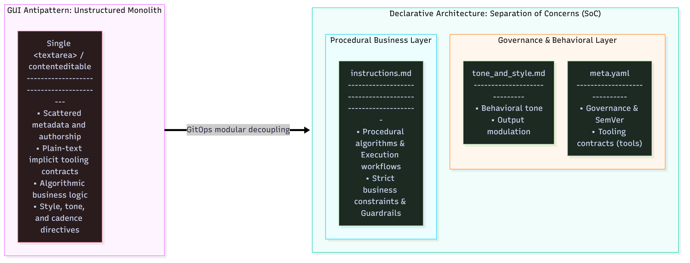
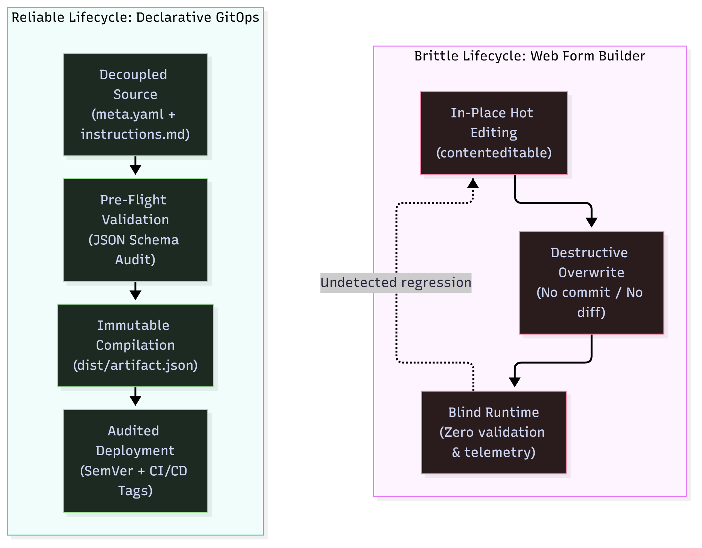

---
title: "From the GPT Store to Oblivion: A Technical Autopsy of AI Walled Gardens"
language: "en"
series: "GemStudio: Prompt-as-Code & Declarative AI Systems"
series_part: 2
category: "AI"
tags: [prompt-as-code, platform-engineering, devops, sre, gemini-gems, gpt-store, software-architecture]
author: "Ricardo Masabel"
date: "2026-10-16"
status: "ready-to-publish"
canonical_target: "LinkedIn Articles"
read_time: "6 - 7 min"
---


# From the GPT Store to Oblivion: A Technical Autopsy of AI Walled Gardens

*Part 2 of 9 in the "GemStudio: Prompt-as-Code & Declarative AI Systems" series · ⏱️ 6 - 7 min read*

> **Series context:** Following the foundation laid in Part 1 regarding the **Prompt-as-Code** methodology, this delivery conducts a forensic postmortem on the structural limits of web-based assistant builders (GPT Store, Gemini Gems). We break down why the form-driven GUI model, decoupled from the software delivery lifecycle, failed from an engineering standpoint.

---

```text
RFC: 0002-ASSISTANT-UI-POSTMORTEM
Scope: LLM Application Lifecycle & State Management
Status: Deprecated Architecture Analysis
Severity: Critical Failure in Enterprise Workflows
Target Systems: Web GUI Form Builders (GPT Store, Gemini Gems)

```

---

In late 2023, the prevailing industry narrative claimed that specializing foundation models would mirror the 2008 mobile App Store boom. Packaging natural language instructions inside a web form, attaching static documents, and toggling a couple of feature switches was allegedly enough to ship a commercial-grade assistant.

Three years later, the diagnosis is indisputable: **the isolated web interface model for custom assistants has collapsed as an engineering discipline.**

This failure did not stem from a lack of user adoption, but from a fundamental architectural incompatibility: attempting to operate critical software artifacts within a reactive browser field without traceability, data contracts, or deterministic delivery pipelines.

---

## 1. The Prompt "App Store" Mirage and the Wrapper Trap

Commercial assistant marketplaces operated under the premise that a prompt wrapped in a proprietary interface constituted standalone software. Production reality proved otherwise: 95% of published catalogs were shallow wrappers consisting of three descriptive lines and an unindexed text document.

> ***# Typical anatomy of a commercial micro-assistant:***
> *"Act as a senior software architect specializing in AWS. Review the provided architecture and suggest cost optimizations following the Well-Architected Framework..."*

The evolution of foundation models dismantled this business model on two fronts:

* **Cannibalization via context and reasoning:** As LLMs reached multi-million-token context windows and refined native chain-of-thought reasoning, they began resolving these heuristics in a single conversational turn without requiring brittle pre-configurations.
* **Zero-Moat Architecture:** A mobile application compiles into an independently distributable binary; a web assistant is merely an arbitrary string residing in a third-party proprietary database, offering zero IP retention or architectural defensibility.

---

## 2. The Three Failure Modes: Forensic Teardown of Web GUIs

The core issue does not lie within the cognitive reasoning of the underlying models, but within the pathologies introduced by web form editing.

### Failure Mode 1: In-Place Destructive Overwrites

Within commercial web builders (***contenteditable***, ***textarea***), persistence is inherently destructive:

* **Hot-swapping production state:** Every click on "Save" overwrites the active production state without generating a cryptographic commit hash. There are no commits, tags, or staging environments.
* **Inability to isolate experiments:** Developers cannot branch off feature branches (***feature branches***) to validate prompt tweaks without impacting active end users.
* **Absence of deterministic rollbacks:** When a subtle wording change degrades the model's structural constraints, recovering yesterday's known-good configuration with surgical certainty becomes impossible.

### Failure Mode 2: Missing Contracts and Validation Blindness

Visual builders operate under passive acceptance: they take arbitrary plain text without asserting payload integrity.

* They lack static linters capable of blocking deployment if operational metadata or formal Semantic Versioning (***MAJOR.MINOR.PATCH***) is omitted.
* They fail to catch logic inconsistencies at design time: demanding tool invocations in procedural text while leaving those capabilities disabled in the platform toggles causes silent runtime failures.
* Validation shifts entirely to runtime, leaving end users exposed to schema degradation and hallucinations.

### Failure Mode 3: Collapse of Separation of Concerns (SoC)

Production-grade assistants require four decoupled architectural layers: governance metadata, tool contracts, procedural algorithmic workflows, and behavioral style guardrails.

Forcing all these responsibilities into a single monolithic block of text guarantees that tweaking tone or phrasing will inadvertently contaminate business logic, drastically increasing regression risks.

* **Figure 1 (Matrix Decomposition: SoC Collapse in Web Forms vs. Modular Git Decoupling):**


---

## 3. Lifecycle Topology: Web Form vs. Declarative GitOps

The fragility of manual UI interaction contrasts sharply with an automated, declarative delivery pipeline:

* **Figure 2 (Topological Comparison: Mutable Web Lifecycle vs. Declarative GitOps Pipeline):**


---

## 4. Socratic Teardown: Interrogating the GUI Approach

To measure the technical debt embedded in web builders, evaluate common workflows against standard software reliability baselines:

* **How do you execute automated regression tests inside a browser tab?**
You cannot. Validating prompt alterations in place relies on conversational trial and error, violating continuous delivery principles.
* **How do you audit a diff caused by an accidental paste into a rich-text container?**
There is no atomic history. A copy-paste mistake or an inadvertent clipboard flush irreversibly corrupts production state.
* **How do you maintain environment parity (dev, staging, prod)?**
Web builders do not support branching. The test canvas runs on the exact same instance handling production queries.
* **What happens to your operational directives during an abrupt platform migration?**
When an interface redesigns, deprecates features, or overhauls its layout, assistants trapped within that vendor silo face immediate obsolescence.

---

## 5. The Ultimate Symptom: Platform Churn

The forced migration of Google Gemini Gems to Skills scheduled for **November 17, 2026**, is not an isolated event: it is proof that passive assistant catalogs are inherently transient.

Consumer-oriented SaaS platforms prioritize rapid UI iterations over backward compatibility. When layout engines change or catalog schemas shift, developers who treat browser forms as their source of truth must manually reconstruct their setups.

Treating prompts as decoupled code guarantees architectural sovereignty: the engineering asset is neither Google's UI nor OpenAI's store, but the auditable specification committed to your version control system.

---

## 6. Architectural Matrix: Walled Garden GUI vs. Declarative Pipeline

The divide between both paradigms spans five architectural dimensions:

**Single Source of Truth:**
* *Walled Garden Web UI:* Opaque proprietary database hosted in vendor infrastructure.
* *Declarative Prompt-as-Code:* Local, version-controlled, and fully auditable Git repository.


**Change Control & Traceability:**
* *Walled Garden Web UI:* Destructive in-place overwrites with zero change history.
* *Declarative Prompt-as-Code:* Atomic Conventional Commits and surgical forensic inspection via ***git blame***.


**Data Governance & Payload Validation:**
* *Walled Garden Web UI:* Passive plain-text ingestion without contract enforcement.
* *Declarative Prompt-as-Code:* Strict schema contracts enforced via JSON Schema (Draft 2020-12).


**Separation of Concerns (SoC):**
* *Walled Garden Web UI:* Monolithic unstructured text blob (metadata + tooling + logic + tone).
* *Declarative Prompt-as-Code:* Physical modular decoupling (***meta.yaml***, ***instructions.md***, ***tone_and_style.md***).


**Portability & Sovereignty:**
* *Walled Garden Web UI:* Hard lock-in to vendor-controlled browser interfaces.
* *Declarative Prompt-as-Code:* Neutral: compiles to clean JSON manifests usable across APIs, custom agents, or local runtimes.

---

## Conclusion: Diagnosis Closed, Engineering Begins

Commercial assistant stores served a pedagogical purpose: introducing customized LLM interactions to the broader public. However, as an engineering solution for resilient, enterprise-grade workflows, the form-builder approach has run its course.

Fixing this fragility does not require prettier interfaces; it demands the operational rigor of distributed systems, immutable infrastructure, and declarative pipelines.

In **Part 3** (*"Thinking Like DevOps in the Age of LLMs: The Origins of the GemStudio Approach"*), we explore how the core tenets of SRE, Infrastructure as Code (IaC), and continuous integration allow engineering teams to govern non-deterministic AI systems with the same predictability applied to mission-critical infrastructure.
