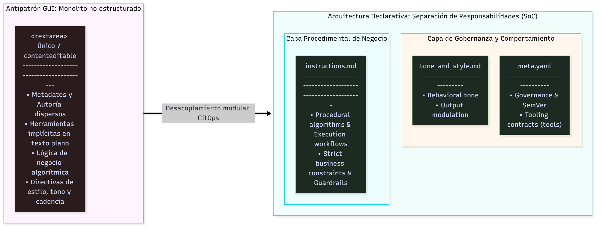
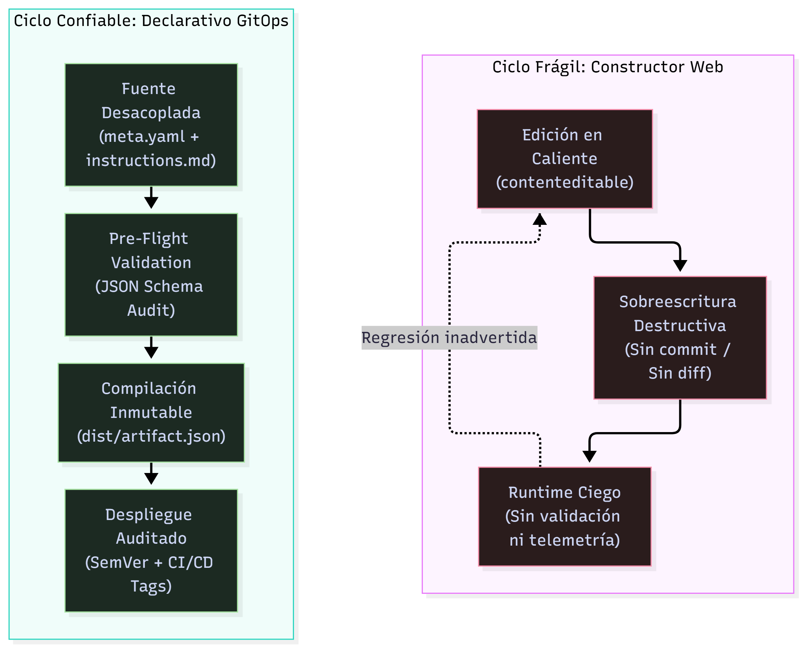

---
title: "De la GPT Store al olvido: autopsia técnica a los jardines vallados de IA"
language: "es"
series: "GemStudio: Prompt-as-Code & Declarative AI Systems"
series_part: 2
category: "AI"
tags: [prompt-as-code, platform-engineering, devops, sre, gemini-gems, gpt-store, software-architecture]
author: "Ricardo Masabel"
date: "2026-10-16"
status: "ready-to-publish"
canonical_target: "LinkedIn Articles"
read_time: "6 - 7 min"
---


# De la GPT Store al Olvido: Autopsia Técnica a los Jardines Vallados de la IA

*Entrega 2 de 9 de la serie "GemStudio: Prompt-as-Code & Declarative AI Systems" · ⏱️ 6 - 7 min de lectura*

> **Contexto de la serie:** Tras establecer en la Entrega 1 el marco metodológico de **Prompt-as-Code**, esta entrega somete a arbitraje forense los límites estructurales de los constructores web de asistentes (GPT Store, Gemini Gems). Analizamos por qué el modelo de formularios desacoplados del ciclo de vida del software colapsó operativamente.

---

```text
RFC: 0002-ASSISTANT-UI-POSTMORTEM
Scope: LLM Application Lifecycle & State Management
Status: Deprecated Architecture Analysis
Severity: Critical Failure in Enterprise Workflows
Target Systems: Web GUI Form Builders (GPT Store, Gemini Gems)

```

---

A finales de 2023, la narrativa predominante de la industria proclamó que la especialización de modelos fundacionales seguiría la estela de la App Store de 2008. Bastaba encapsular directivas en lenguaje natural en un formulario web, adjuntar archivos estáticos y conmutar un par de selectores para comercializar un asistente inteligente.

Tres años después, el diagnóstico es inapelable: **el modelo de interfaces web aisladas para la personalización de asistentes ha fracasado como solución de ingeniería.**

El colapso no fue provocado por falta de adopción de los usuarios, sino por una incompatibilidad arquitectónica de fondo: pretender gestionar activos críticos de software dentro de un campo reactivo del navegador sin trazabilidad, sin esquemas y sin pipelines de validación deterministas.

---

## 1. El Espejismo de la "App Store" de Prompts y la Trampa del Wrapper

Las tiendas comerciales de asistentes asumieron que un prompt empaquetado en una interfaz propietaria constituía un producto de software independiente. La realidad operativa demostró que el 95% de los catálogos correspondía a envoltorios superficiales (*shallow wrappers*): tres líneas descriptivas y un documento plano.

> ***# Anatomía típica de un micro-asistente comercial:***
> *"Actúa como un arquitecto de software senior especializado en AWS. Revisa la arquitectura proporcionada y sugiere optimizaciones de coste según el Well-Architected Framework..."*

La evolución de los modelos fundacionales evaporó este modelo de negocio en dos frentes simultáneos:

* **Canibalización por contexto y razonamiento:** A medida que los LLMs alcanzaron ventanas de millones de tokens y refinaron su razonamiento en cadena (*chain-of-thought*), resolvieron estas heurísticas en un único turno conversacional sin requerir preconfiguraciones rígidas.
* **Cero foso defensivo (*Zero-Moat Architecture*):** Un ejecutable móvil es un binario compilado y distribuible; un asistente web es solo una cadena de texto arbitraria expuesta en la base de datos de un tercero sin garantías de retención ni propiedad intelectual real.

---

## 2. Los Tres Modos de Fallo: Deconstrucción Forense de la GUI Web

El problema fundamental no radica en la capacidad cognitiva de los modelos, sino en las patologías que introduce el medio de edición.

### Modo de Fallo 1: Mutabilidad Destructiva in-situ (*In-Place Overwrites*)

En un formulario web comercial (***contenteditable***, ***textarea***), la persistencia es destructiva por definición:

* **Sobreescritura en caliente:** Cada clic en "Guardar" sustituye el estado activo en producción sin generar un hash criptográfico de seguimiento. No existe el concepto de ***commit***, ***tag*** o ***staging***.
* **Imposibilidad de aislamiento:** No se pueden instanciar ramas (***feature branches***) para ensayar variaciones heurísticas de un prompt sin alterar la experiencia de los consumidores activos.
* **Ausencia de rollback determinista:** Si un ajuste sutil en la redacción degrada las restricciones de salida del modelo, resulta inviable recuperar con certeza quirúrgica la versión exacta que funcionaba ayer.

### Modo de Fallo 2: Contratos Inexistentes y Ceguera de Validación

Los constructores visuales operan bajo una asunción pasiva: aceptan cualquier entrada de texto plano sin validar la integridad del artefacto.

* No existen analizadores estáticos que impidan el guardado si se omite un metadato operativo o un versionado semántico formal (***MAJOR.MINOR.PATCH***).
* No se previenen inconsistencias lógicas en tiempo de diseño: exigir en el texto procedimental la invocación de herramientas externas mientras se mantienen deshabilitadas en la interfaz genera fallos silenciosos.
* La validación queda transferida en su totalidad al *runtime*, exponiendo a los usuarios a alucinaciones o degradaciones de formato.

### Modo de Fallo 3: Colapso de la Separación de Responsabilidades (SoC)

Un asistente industrial exige distinguir formalmente cuatro capas desacopladas: metadatos de gobernanza, herramientas activas, directivas procedimentales algorítmicas y pautas de comportamiento/estilo.

Al forzar la condensación de todas estas responsabilidades en una masa monolítica de texto, cualquier modificación de tono contamina directamente las reglas de negocio, multiplicando el riesgo de regresiones operativas.

* **Figura 1 (Descomposición matricial: Colapso de SoC en formulario web vs. Separación modular en Git):**


---

## 3. Topología del Ciclo de Vida: Web Form vs. Declarativo

La fragilidad del flujo interactivo tradicional contrasta con la estabilidad de una cadena de entrega automatizada:

* **Figura 2 (Comparativa topológica entre el ciclo de vida web mutable y el pipeline declarativo):**


---

## 4. Deconstrucción Socrática: Preguntas al Enfoque de Interfaz

Para dimensionar la deuda técnica acumulada en los editores web, basta someter el modelo mental habitual a interrogantes elementales de fiabilidad de software:

* **¿Cómo ejecutas un test de regresión en una pestaña del navegador?**
No es posible. Cualquier alteración de directivas en caliente se valida mediante ensayo y error conversacional, degradando el estándar de entrega continua.
* **¿Cómo auditas un diff de un pegado accidental en un cuadro de texto enriquecido?**
No existe historial atómico. Un error de copiado o una limpieza accidental del portapapeles sobreescribe el estado operativo de forma irreversible.
* **¿Cómo gestionas la paridad de entornos (dev, staging, prod)?**
El entorno web no admite bifurcaciones. El lienzo de pruebas es idéntico a la instancia productiva en ejecución.
* **¿Qué sucede con tus directivas operativas ante una migración forzada de plataforma?**
Si la interfaz muta, restringe funcionalidades o depreca el módulo, los asistentes creados en su interior quedan atrapados en el silo del proveedor.

---

## 5. El Síntoma Definitivo: Volatilidad de Plataforma (*Platform Churn*)

El anuncio de migración obligatoria de Google Gemini Gems hacia Skills a partir del **17 de noviembre de 2026** no es un incidente aislado: es la confirmación explícita de que los catálogos pasivos de asistentes son transitorios.

Las plataformas SaaS orientadas a consumo no garantizan retrocompatibilidad sobre constructores gráficos. Cuando la interfaz se rediseña o la taxonomía del catálogo muta, los desarrolladores que mantuvieron sus directivas atrapadas en el navegador se ven forzados a rehacer configuraciones manualmente.

Tratar los prompts como código desacoplado garantiza la soberanía del diseño: el artefacto de ingeniería no es la interfaz de Google ni el catálogo de OpenAI, sino la especificación auditable alojada en tu propio repositorio.

---

## 6. Matriz de Arquitectura: GUI Cautiva vs. Declarativo

| Dimensión | Walled Garden Web UI (GPTs / Gems) | Prompt-as-Code Declarativo |
| --- | --- | --- |
| **Fuente de Verdad** | Base de datos propietaria opaca | Repositorio Git versionado localmente |
| **Control de Cambios** | Sobreescritura in-place no versionada | Conventional Commits y trazabilidad ***git blame*** |
| **Gobernanza de Datos** | Aceptación ciega de texto plano | Contrato estricto (JSON Schema Draft 2020-12) |
| **Separación de Capas** | Monolito de texto (metadatos + lógica + estilo) | Desacoplamiento modular (***meta.yaml***, ***instructions.md***) |
| **Portabilidad** | Cautiva al entorno gráfico del proveedor | Neutral: compilable a JSON, APIs o agentes autónomos |

---

## Conclusión: El Diagnóstico Cierra, Comienza la Ingeniería

Las tiendas de asistentes comerciales cumplieron un rol pedagógico de transición: acercaron la personalización de los modelos fundacionales al público masivo. Sin embargo, como solución para flujos de trabajo profesionales e industriales, han agotado su recorrido.

La fragilidad observada no se repara con mejores interfaces gráficas, sino adoptando la disciplina operativa de los sistemas distribuidos y la infraestructura inmutable.

En la **Entrega 3** (*"Pensar como DevOps en la era de los LLMs: el origen del enfoque GemStudio"*), abordaremos cómo los principios fundacionales de SRE, Infrastructure as Code (IaC) y entrega continua permiten gobernar artefactos de IA no deterministas con el mismo rigor y reproducibilidad que una flota de producción.
